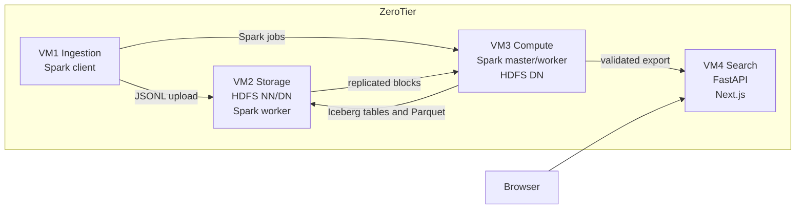
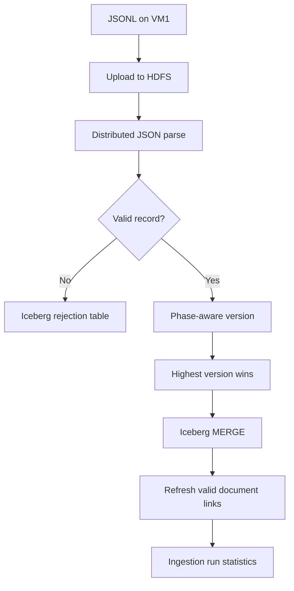
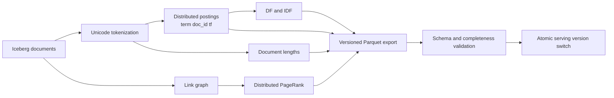

# Architecture

## System Context

## Responsibility Boundaries

- VM1 owns raw JSONL, validation, and ingestion drivers. It has `spark-submit` but no Spark or HDFS daemon.
- VM2 owns the HDFS NameNode, one DataNode, the Iceberg warehouse, and one Spark worker.
- VM3 owns the Spark master, one worker, one DataNode, and index/PageRank/export drivers.
- VM4 owns only serving state. It downloads a validated export and performs no Spark or Iceberg query during a search.

## Ingestion Flow

A phase is repeatable. The documents table uses `doc_id` as its logical key and only accepts a source version at least as new as the stored version. Phase 0 defaults to document version 1 and Phase 1 to version 2 when the official input omits `version`.

## Index and Ranking Flow

## Serving Model

The serving export contains:

| Artifact | Purpose |
|---|---|
| `metadata.json` | Version, phase, counts, ranking parameters, and file manifest |
| `documents.parquet` | Document metadata, text, and document length |
| `postings.parquet` | Term-to-document postings and term frequency |
| `terms.parquet` | Document frequency and IDF |
| `pagerank.parquet` | Final PageRank score for every document |

VM4 loads these files into memory. Search performs posting-list lookup, BM25 scoring, candidate-set normalization, and hybrid sorting without contacting Spark, HDFS, or Iceberg.

## Consistency and Recovery

- Iceberg provides table snapshots, atomic commits, schema evolution, and time travel.
- Exports are immutable and versioned.
- VM4 downloads into a temporary directory and validates before moving into the serving root.
- The `current` symlink is replaced atomically with `rename`.
- A failed download, validation, or export leaves the current version untouched.
- The previous version remains available for rollback through `VersionManager.rollback()`.

## Design Decisions

1. HadoopCatalog is used instead of a Hive metastore because the assignment requires Iceberg on HDFS but does not require a shared SQL service.
2. Standalone Spark is used because the assignment specifies a Spark master and workers.
3. BM25 and PageRank are separated: Spark produces static scores and the API performs query-time candidate ranking.
4. The official dataset has no explicit version field, so phase defaults provide a deterministic version while still accepting an explicit `version` in future data.
